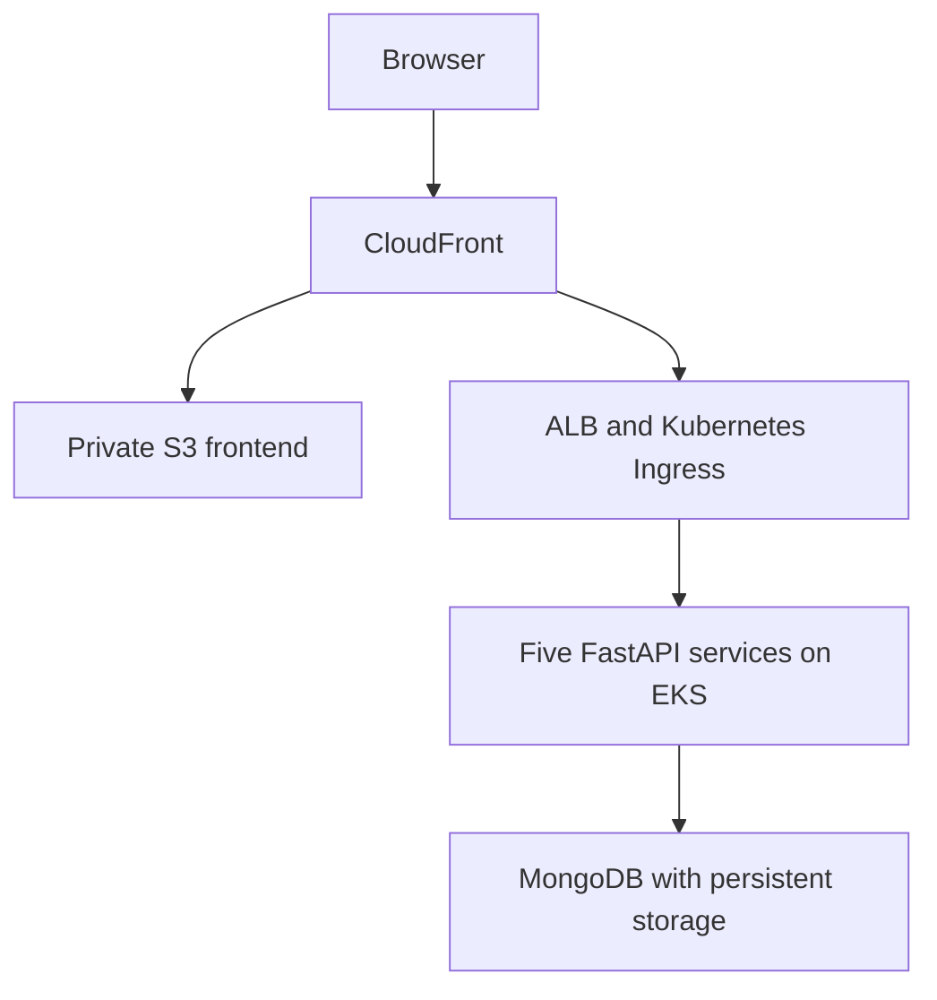

# Sports Store — Microservices

A team DevOps capstone taking an e-commerce application from local containers to AWS infrastructure and GitOps delivery. Identity, catalog, carts, checkout and mock payments are maintained as separate services.

This repository is a portfolio guide. Original code and history remain in the [Sports Store organization](https://github.com/orgs/sports-store-devops-team/repositories).

## Architecture

CloudFront serves the React/Vite frontend from private S3 through Origin Access Control and forwards uncached API requests to the ALB. Ingress maps paths directly to backend Services. The NGINX gateway is a local Docker Compose adapter; Minikube also uses direct Ingress routing.

## Source repositories

| Component | Responsibility | Source |
| --- | --- | --- |
| Frontend | React/Vite storefront and static publication | [frontend](https://github.com/sports-store-devops-team/sports-store-frontend) |
| Authentication | Registration, login, JWT and identity | [auth-service](https://github.com/sports-store-devops-team/sports-store-auth-service) |
| Catalog | Products, variants and stock operations | [catalog-service](https://github.com/sports-store-devops-team/sports-store-catalog-service) |
| Cart | Customer carts and catalog-backed validation | [cart-service](https://github.com/sports-store-devops-team/sports-store-cart-service) |
| Orders | Checkout coordination and persistence | [order-service](https://github.com/sports-store-devops-team/sports-store-order-service) |
| Payments | Mock approvals and declines | [payment-service](https://github.com/sports-store-devops-team/sports-store-payment-service) |
| Infrastructure | Terraform AWS foundation and bootstrap | [infrastructure](https://github.com/sports-store-devops-team/sports-store-infrastructure) |
| Deployments | Helm, Kubernetes and observability | [deployments](https://github.com/sports-store-devops-team/sports-store-deployments) |
| Local environment | Docker Compose and MongoDB persistence | [local](https://github.com/sports-store-devops-team/sports-store-local) |
| Local gateway | NGINX same-origin adapter | [gateway](https://github.com/sports-store-devops-team/sports-store-gateway) |

## Technologies and infrastructure

- Application: React, Vite, Python, FastAPI, JWT and MongoDB.
- Containers: Docker, Docker Compose, Kubernetes, Helm and Amazon EKS.
- AWS: Terraform-defined VPC across two availability zones, public/private subnets, NAT Gateway, EKS managed nodes, ECR, S3, CloudFront, ALB and EBS CSI.
- Delivery: GitHub Actions, AWS OIDC federation, Argo CD and Argo CD Image Updater.
- Secrets: AWS Secrets Manager and External Secrets Operator with scoped workload IAM roles.
- Observability: Prometheus, Grafana, Loki, Alloy and CloudWatch control-plane logs.

## CI/CD and GitOps

1. Backend pull requests run pytest and container validation. Main publication uses temporary OIDC credentials and immutable version/commit image tags in ECR.
2. Frontend validation builds the application and container. Main publication synchronizes static content to the private S3 bucket.
3. Deployment CI lints YAML/Helm, renders local and AWS values, checks behavior and Kubernetes schemas, validates logging configuration, and runs Trivy secret/misconfiguration scans.
4. Argo CD reconciles version-controlled workload and observability configuration. Image Updater is configured for the image delivery model. Backend CI publication does not directly deploy to EKS.
5. Terraform owns AWS infrastructure and platform bootstrap. A separate CloudFront root resolves the dependency on the ALB hostname created through Kubernetes.

## My contribution

I contributed to the shared deployment repository as **NivBar2000**. Public history records my involvement in deployment configuration, including the Loki/Alloy logging stack. These are team-maintained repositories; I do not claim sole authorship of the system.

Evidence: [my deployment commits](https://github.com/sports-store-devops-team/sports-store-deployments/commits?author=NivBar2000) and [logging-stack commit](https://github.com/sports-store-devops-team/sports-store-deployments/commit/04c328bc96e534e1649472b6c63e9874286d3b26).

## Explore and run

Start with the local environment repository for sibling-repository setup and Docker Compose. Read the infrastructure and deployment runbooks before provisioning AWS resources.

This educational capstone uses mock payments. The guide describes implemented configuration, not a guarantee of a currently running AWS environment. The shared NAT and small observability storage are course-environment trade-offs. Never commit credentials; review infrastructure changes and persistent-data implications before apply or destroy.
